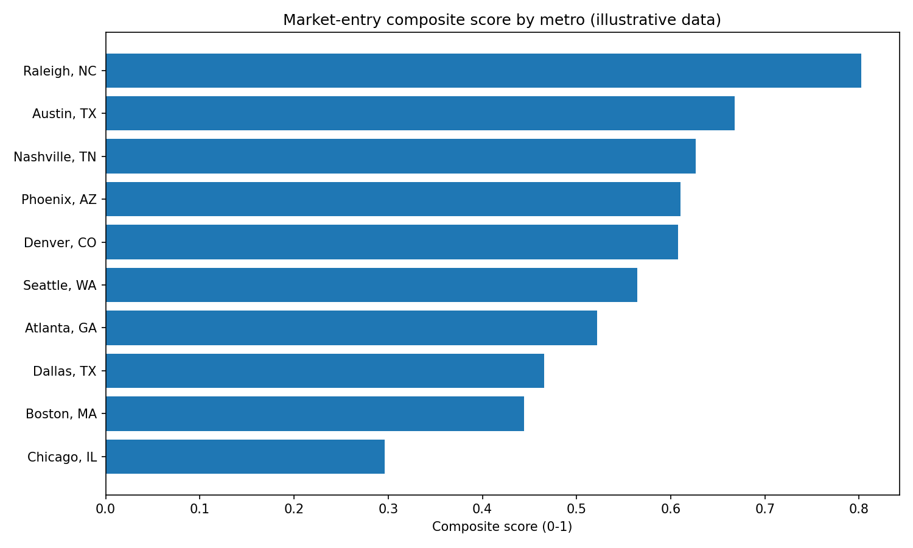
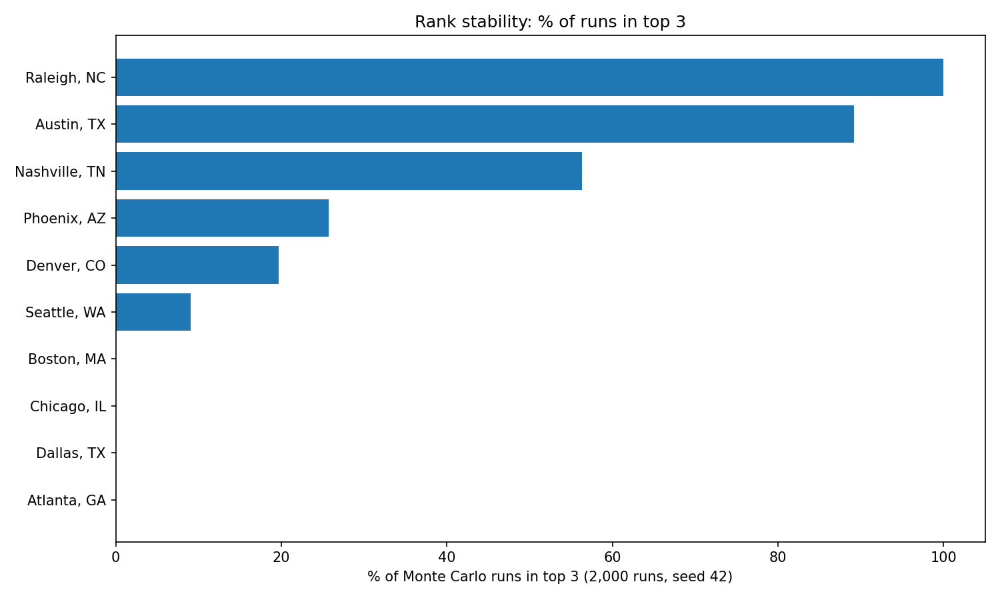

# Market-Entry Prioritization Model with Monte Carlo Sensitivity Analysis

**Python · pandas · Excel (openpyxl) · matplotlib**

A weighted scoring model that ranks 10 candidate US metro areas for market
entry, then stress-tests that ranking by perturbing the weights 2,000 times.
The point of the project is the *method* — transparent normalisation,
documented weights, and an honest stability check — not a recommendation to
enter any real market on these numbers (see Limitations).

> ⚠️ **Data warning — read first.** The indicator values in this project are
> **illustrative, author-set values, NOT official FRED, BLS, or Census
> statistics.** Public no-key attempts were made first (see
> [DATA_SOURCES.md](DATA_SOURCES.md)): the Census API redirected to a
> missing-key page, and FRED's no-key CSV is national-level only. The
> illustrative dataset is labelled as such in every file that carries it.
> Do not quote any metro value here as a real statistic.

## Results (actually computed by `src/run_all.py`, seed 42, 2,000 runs)

### Base ranking (composite score, 0–1)

| Rank | Metro | Composite score |
|---:|---|---:|
| 1 | Raleigh, NC | 0.8026 |
| 2 | Austin, TX | 0.6677 |
| 3 | Nashville, TN | 0.6264 |
| 4 | Phoenix, AZ | 0.6103 |
| 5 | Denver, CO | 0.6075 |
| 6 | Seattle, WA | 0.5643 |
| 7 | Atlanta, GA | 0.5219 |
| 8 | Dallas, TX | 0.4654 |
| 9 | Boston, MA | 0.4445 |
| 10 | Chicago, IL | 0.2962 |

### Monte Carlo stability (2,000 runs, seed 42)

- **Base top-3 set {Raleigh, Austin, Nashville} unchanged in 45.9% of runs.**
  That is the headline stability finding: the #1 spot is rock-solid, but the
  third slot is contested — so the top 3 as a *set* is only moderately stable.
- % of runs in the top 3: Raleigh 100.0%, Austin 89.2%, Nashville 56.3%,
  Phoenix 25.75%, Denver 19.7%, Seattle 9.05%, Atlanta / Dallas / Boston /
  Chicago 0.0% each.
- Mean rank / rank range: Raleigh 1.0 (1–1), Austin 2.286 (2–5),
  Nashville 3.516 (2–6), Phoenix 4.437 (2–8), Denver 4.372 (2–6),
  Seattle 5.803 (2–8), Atlanta 6.888 (5–9), Dallas 8.313 (7–9),
  Boston 8.398 (5–10), Chicago 9.986 (9–10).
- Full per-metro table: `outputs/metrics.json` and the Monte Carlo sheet of
  `outputs/market_entry_model.xlsx`.




## Method

1. **Indicators (7, at least 2 per dimension).** See definitions below.
2. **Normalisation — min-max on the observed 10-metro range**, per indicator:
   - higher = better: `(x − min) / (max − min)`
   - lower = better: `(max − x) / (max − min)`
   - A constant column would map to 0.5 (guard in code).
3. **Composite score** = Σ (weight × normalised indicator). Weights sum to 1.0.
4. **Monte Carlo**: each run multiplies every base weight by
   exp(N(0, 0.30)) (lognormal perturbation, σ = 0.30), renormalises to sum 1.0,
   recomputes the ranking, and records ranks. Seed fixed at 42, 2,000 runs.
   This tests *weight sensitivity only* — it does not simulate demand, costs,
   or market outcomes and is not a forecast.

## Indicator definitions

| Dimension | Indicator | Unit | Direction | Meaning |
|---|---|---|---|---|
| Demand | `pop_growth_pct` | % / year | higher = better | Illustrative population growth rate |
| Demand | `median_hh_income_usd` | USD / year | higher = better | Illustrative median household income (purchasing power) |
| Demand | `bachelor_plus_pct` | % of adults | higher = better | Illustrative share with a bachelor's degree or higher (skilled-demand proxy) |
| Labor cost | `median_hourly_wage_usd` | USD / hour | lower = better | Illustrative median hourly wage (hiring cost) |
| Labor cost | `office_rent_usd_sqft_yr` | USD / sq ft / year | lower = better | Illustrative office rent (occupancy cost) |
| Competition | `competitors_per_100k` | count / 100k people | lower = better | Illustrative incumbent competitor density |
| Competition | `incumbent_share_pct` | % of market | lower = better | Illustrative combined share of leading incumbents |

## Weights — a documented exercise, NOT a stakeholder vote

These weights were set by the author to encode a stated priority order.
No stakeholder was surveyed and no vote took place; a real project would
replace them with elicited weights and re-run the Monte Carlo.

| Dimension | Weight | Rationale |
|---|---|---|
| Demand | 0.45 | Entry is demand-led: without growth, income, and skilled demand, low costs alone do not justify entry. Split equally (0.15 each) across its 3 indicators because no single demand proxy should dominate. |
| Labor cost | 0.30 | Operating cost is the second binding constraint on a new office/operation. Split equally (0.15 each) between wages and rent. |
| Competition | 0.25 | A crowded, incumbent-dominated market slows share gains, but it is a moderator, not the driver — hence the smallest dimension weight. Split equally (0.125 each). |

Per-indicator weights (sum = 1.0): pop growth 0.15, median income 0.15,
bachelor's+ 0.15, hourly wage 0.15, office rent 0.15, competitors/100k 0.125,
incumbent share 0.125.

## How to run

```bash
pip install -r requirements.txt
python3 src/run_all.py
```

This regenerates `data/metro_indicators.csv`, `outputs/metrics.json`,
`outputs/market_entry_model.xlsx`, and both charts in `outputs/charts/`.
Verify the code compiles: `python3 -m py_compile src/*.py`.

## Files

- `src/fetch_data.py` — probes Census/FRED, falls back to illustrative data
- `src/generate_illustrative_data.py` — the illustrative table (labelled)
- `src/scoring_model.py` — normalisation, weighting, ranking
- `src/monte_carlo.py` — weight perturbations, rank stability
- `src/build_workbook.py` — Excel workbook (Sheets: Scores, Weights, Monte Carlo, Indicators, README_Notes)
- `src/run_all.py` — full pipeline
- `data/metro_indicators.csv` — indicator data (illustrative)
- `outputs/market_entry_model.xlsx`, `outputs/metrics.json`, `outputs/charts/`
- `docs/executive_memo.md` — one-page memo

## Limitations

- **Illustrative data.** Rankings move with real data; replace the table with
  cited ACS/BLS/FRED metro values before any real decision.
- **Min-max normalisation is range-dependent.** Adding or dropping a metro
  rescales every score; scores are relative within this 10-metro set only.
- **Weights are author-set, not elicited.** The Monte Carlo shows what
  happens if those weights are wrong, not what the "right" weights are.
- **No revenue, margin, regulation, talent-supply, or timing analysis.**
  A top rank here is a shortlist signal, not an entry case.
- **Monte Carlo perturbs weights only.** It says nothing about uncertainty
  in the underlying indicator values.
